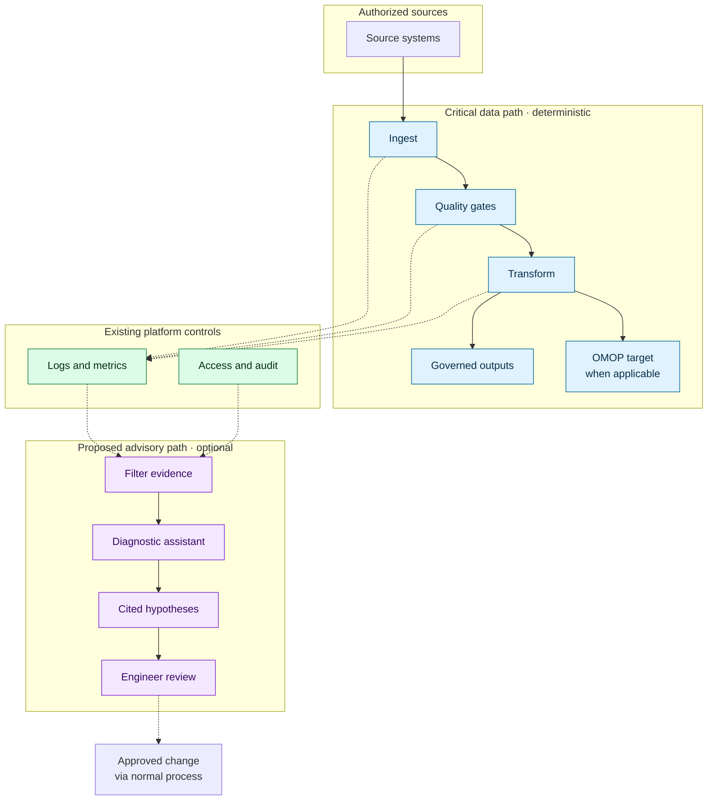
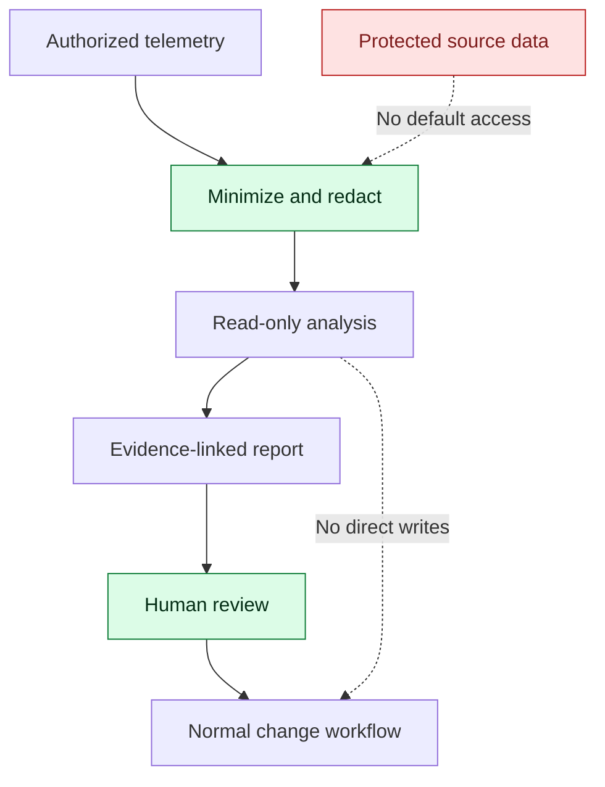

# Intelligent Data Pipeline Engineering

### Secure by Design · Efficient by Architecture · AI-Assisted by Purpose

**An independent study on evidence-grounded pipeline diagnostics in regulated data environments.**

   

[Summary](#summary) · [Findings](#what-the-platform-already-does) · [Open question](#the-narrowed-question) · [Architecture](#reference-architecture) · [Scenario](#illustrative-incident) · [Safety](#security-and-efficiency) · [Evaluation](#evaluation) · [Next steps](#next-steps)

## Summary

- **What this is:** a short study of one question in data engineering: when several pipeline alerts fire together, can an optional, read-only assistant help engineers find the common cause faster, without weakening security or controls?
- **What I checked:** I reviewed official Databricks and Azure Databricks documentation (consulted 2 Nov 2026) to see how much of this the platform already does.
- **What I found:** quite a lot. Error diagnosis, expectation-based quality checks, event logs, lineage and AI-driven anomaly detection already exist natively. The open part is narrower than I first assumed (see below).
- **Decision rule:** if native tooling is adequate, or AI cannot show a measurable benefit under strict security constraints, the AI component should not be added.

> [!NOTE]
> **Independent study, not an HUS project.** It makes no claim about HUS's internal systems or needs, uses no patient data, and describes no implemented solution. A prototype with synthetic data is a possible next step, not a deliverable that exists today.

## What the platform already does

Findings below come from official documentation and Databricks announcements. Several features are in **preview**, and availability varies by edition, region and workspace configuration, so each needs confirming for any specific environment.

| Capability | What the documentation describes | Source |
|---|---|---|
| **Job failure diagnosis** | The Jobs UI offers a *Diagnose Error* action powered by Databricks Assistant (Public Preview when consulted). A Databricks blog says it initially covered notebook tasks only. | [Troubleshoot job failures](https://docs.databricks.com/workflows/jobs/how-to-fix-job-failures.html), [Workflows UI blog](https://databricks.com/blog/enhanced-workflows-ui-reduces-debugging-time-and-boosts-productivity) |
| **AI coding and debugging assistant** | Genie Code works in notebooks, the SQL editor and the Lakeflow Pipelines Editor, uses Unity Catalog metadata and lineage, and can analyse more complex errors, including environment errors. | [Genie Code](https://docs.databricks.com/genie-code) |
| **Rule-based quality checks** | Pipeline expectations let you warn, drop or fail on violations, and emit metrics to the pipeline event log. | [Expectations](https://docs.databricks.com/delta-live-tables/expectations.html) |
| **Pipeline observability** | The pipeline event log records audit information, data quality results, progress and lineage in a queryable Delta table. Some fields are marked as evolving, and the docs advise against building alerts on those. | [Event log schema](https://docs.azure.cn/en-us/databricks/dlt/monitor-event-log-schema) |
| **AI-based table anomaly detection** | Data Quality Monitoring (Public Preview, announced Feb 2026, including Azure Databricks) learns historical patterns, prioritises tables using lineage, links issues to upstream jobs and pipelines, and stores results in system tables. | [Databricks blog](https://databricks.com/blog/data-quality-monitoring-scale-agentic-ai) |
| **Lineage and system tables** | Unity Catalog lineage and system tables can be queried to relate tables, jobs and runs. | [Community discussion with examples](https://community.databricks.com/t5/data-engineering/data-quality-lineage-root-cause-analysis/m-p/165603) |

**Honest reading:** my original idea of a sidecar that explains anomalies overlaps substantially with these features, especially Data Quality Monitoring with upstream root-cause pointers and the Assistant's error diagnosis. Anyone proposing an additional AI layer must show what these do not cover.

## The narrowed question

What is *not* clearly covered by the documentation I reviewed, and therefore remains **open (hypothesis, not finding)**:

1. **Cross-signal correlation with cited evidence.** Native tools diagnose a failed job, or flag an anomalous table. It is unclear whether any of them connects *several* signals, such as a late delivery, a schema change and a downstream failure, into one explanation that cites specific logs and schema versions and separates fact from hypothesis.
2. **Use in a strict regulated context.** Many of the relevant features are in preview. For a healthcare organisation the practical questions are which model processes the logs, where, under which data-residency terms, with what audit trail, and whether the feature may be enabled at all.
3. **Governance of the advisory output.** Whether the explanation can be made read-only, minimised, reproducible and reviewable by an engineer before anything changes.

If native tools already answer 1 to 3 in a given environment, the right outcome is to use them and stop.

## Reference architecture

A technology-agnostic reference design, not a map of any real deployment. Solid arrows are data processing; dashed arrows are operational evidence or human-approved feedback.

**Rules:**

- The pipeline runs without the assistant, and mandatory quality gates can never be bypassed.
- The assistant sees only authorized, minimized operational evidence (metrics, schema versions, sanitized logs) and has no write access to source records or production pipelines.
- An engineer validates every conclusion and uses the normal change process.
- OMOP is a common data model used as a **transformation target**, not an operational source comparable to a patient record system.
- The advisory path could be built from native components where they fit, so the sidecar may be a thin layer or may not be needed at all.

## Illustrative incident

**Three alerts, one possible upstream cause.** A synthetic exercise, not a recorded incident or a benchmark.

| Alert | Deterministic observation | Evidence to correlate |
|---|---|---|
| A · Volume | Fewer records arrive than expected | Delivery timestamps, upstream run history |
| B · Schema | A downstream field becomes unexpectedly null | Source schema versions, column mappings |
| C · Execution | A dependent transformation fails | Job dependencies, error logs |

**Known cause (synthetic):** an upstream schema change shipped shortly before a delayed delivery, and downstream jobs still used the older mapping.

Simple rules can flag each symptom. The test is whether an assistant, compared with native tools alone, can:

1. link the three alerts to one window and one probable cause,
2. cite the specific log lines, timestamps and schema differences,
3. label what is observed versus hypothesised,
4. propose safe verification steps, and
5. leave every decision to the engineer.

## Security and efficiency

Security and efficiency are evaluated together; mandatory controls are not trade-offs.

| Requirement | Safeguard or test |
|---|---|
| Data protection | Least privilege, sanitized logs, no raw patient data by default |
| Integrity | Deterministic quality gates; the assistant never writes to operational data |
| Traceability | Evidence references, audit logs, explicit statement of uncertainty |
| Availability | An assistant outage must not interrupt safe pipeline execution |
| Security testing | Prompt injection through log content, unauthorized access, data leakage |
| Efficiency | End-to-end triage time, inference overhead and cost |

Any healthcare deployment would need its own legal, privacy, security and operational review under applicable EU and Finnish requirements. No compliance is claimed.

## Evaluation

A fair test compares **native tools and deterministic workflows alone** with **the same workflow plus the optional assistant**, using synthetic incidents with known causes.

| Metric | Question |
|---|---|
| Root-cause accuracy | Is the supported diagnosis correct? |
| Evidence quality | Are claims tied to relevant logs, schemas and timestamps? |
| Unsupported claims | Does it invent causes? |
| Engineer effort | Is end-to-end investigation time lower, including review? |
| Overhead | Are latency and compute cost justified? |
| Safety | Do permissions and write restrictions hold under failure? |

**Reject or redesign** the assistant if it does not clearly beat the baseline or adds unacceptable risk.

## Next steps

1. Write 3 or 4 synthetic multi-signal incidents (alerts, logs, schema versions, true cause) in a small `examples/` folder.
2. Run the native diagnosis features on those incidents in a free or trial workspace and record exactly what they do and miss.
3. Update the "narrowed question" section with the results, even if the result is "the platform already covers this."
4. Threat-model the advisory boundary and define safe failure behavior.
5. Decide whether a small prototype is justified.

## Longer-term direction (not part of the baseline)

The earlier exploration also considered internal intelligence for data operations and a policy-governed layer that routes between approved AI services, backed by reusable operational knowledge. These remain **future hypotheses**. They would need separate analysis of privacy, data residency, vendor terms, cost, reliability and authorization, and nothing here assumes protected healthcare data leaves a controlled environment.

## Evidence labels and limits

| Label | Meaning |
|---|---|
| **Verified** | Supported by a primary source or a reproducible test |
| **Inferred** | Reasoned conclusion with stated assumptions |
| **Hypothesis** | Proposal awaiting verification |
| **Rejected** | Discarded after technical or safety review |

Everything in the findings table is *verified against documentation only*, not by running the features. Preview status, naming and availability change often, so re-check before relying on it. I have no access to any organisation's internal systems or telemetry, and public job postings or procurement notices show context, not unmet needs.

Independent individual research, published under the CAUCOLabs namespace. It is not a commercial offer or an official design of any organisation.

---

**Good data engineering first. AI only when justified.**

*Conceptual study · Synthetic scenarios · No clinical data · No claimed deployment*

