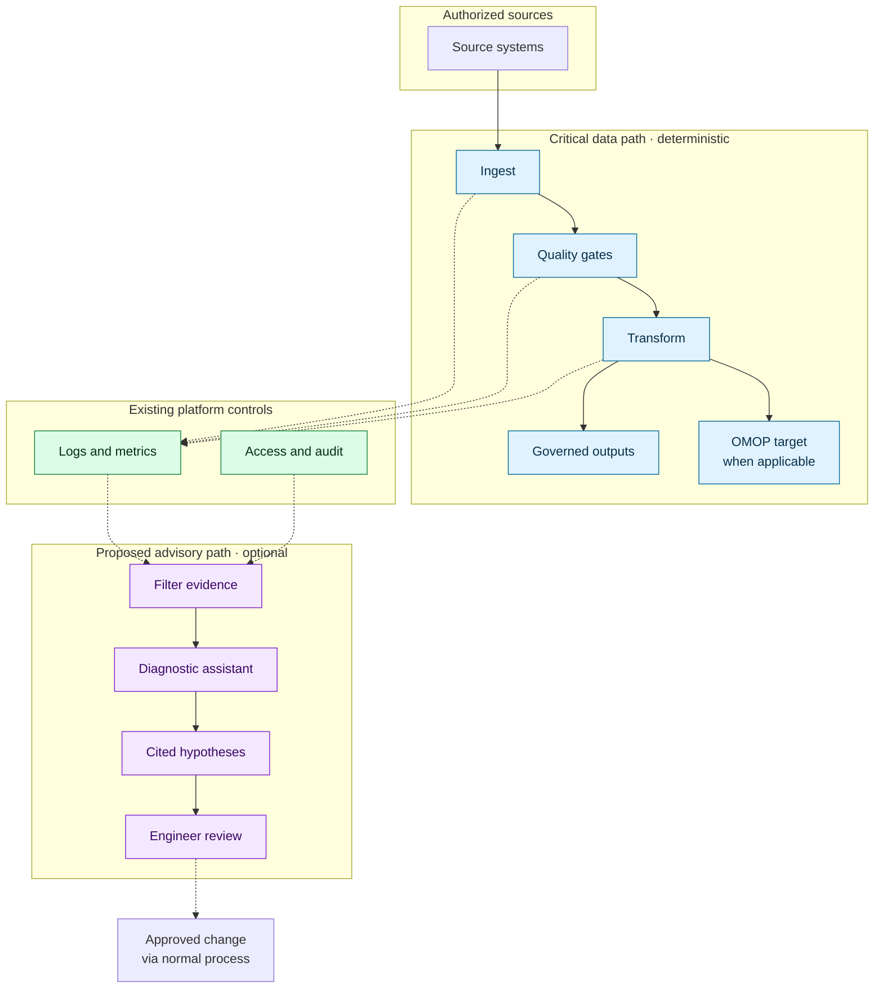
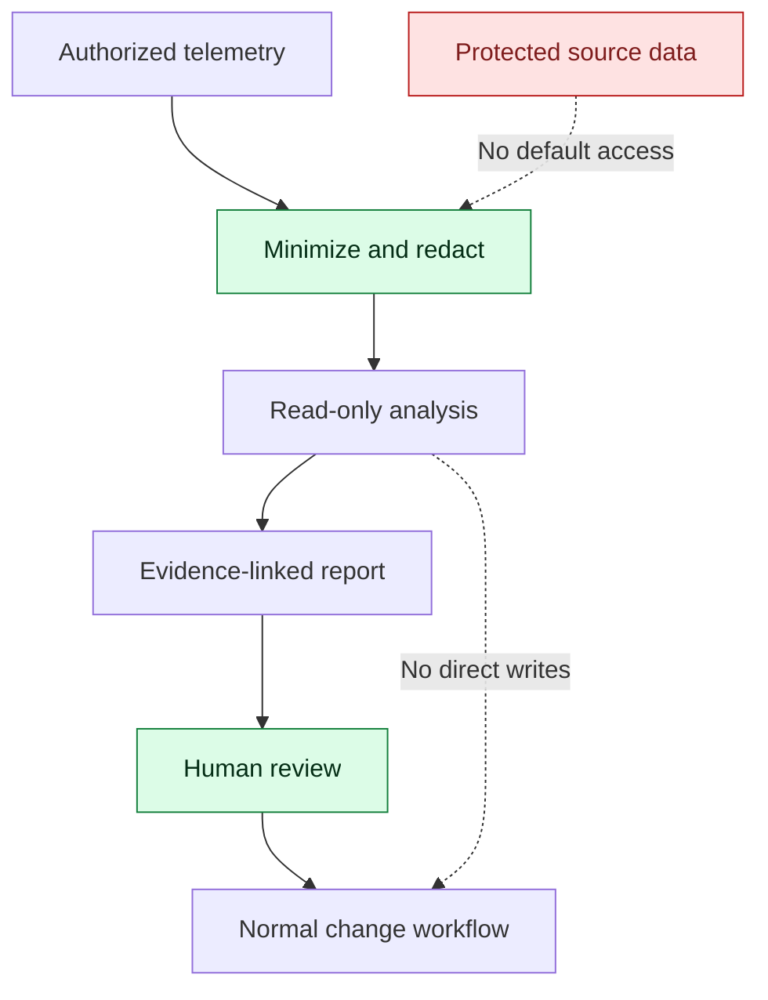

# Intelligent Data Pipeline Engineering

### Secure by Design · Efficient by Architecture · AI-Assisted by Purpose

**An independent architecture proposal for evidence-grounded pipeline diagnostics in regulated data environments.**

  

[Overview](#executive-summary) · [Architecture](#reference-architecture) · [Scenario](#illustrative-incident) · [Existing tools](#what-already-exists--what-remains-to-be-proven) · [Safety](#security-and-efficiency) · [Next steps](#research-and-validation-plan)

> [!NOTE]
> **Independent conceptual study, not an HUS project.** This proposal does not describe HUS's internal systems, assert that HUS has an unmet need, or claim an implemented solution. No patient data is used. A synthetic-data prototype is a *possible future step*, not a completed deliverable.

## Executive summary

Modern data platforms already support ingestion, transformations, quality checks, monitoring, and governance. This study asks whether an **optional, read-only diagnostic assistant** could help engineers connect evidence across related pipeline incidents. **Deterministic controls remain authoritative; AI never sits in the critical processing path.** The design prioritizes security and efficiency together and evaluates platform-native capabilities before proposing custom software. **The incremental value of AI remains unproven** and must be tested against a non-AI baseline.

> **Decision principle:** If existing tools solve the problem adequately—or AI cannot demonstrate measurable benefit without weakening controls—**do not add the AI component**.

## Reference architecture

This is a **technology-agnostic reference architecture**, not a diagram of an actual hospital deployment. Solid arrows represent data processing; dashed arrows represent operational evidence or human-approved feedback.

**Architecture rules:**

- The data pipeline operates without the assistant; mandatory quality gates cannot be bypassed.
- The assistant consumes only **authorized, minimized operational evidence** and cannot write to source records or production pipelines.
- An engineer validates conclusions and uses established change-management workflows.
- **OMOP is a common data model that can be a transformation target**, not an operational source comparable to an electronic health record.
- Azure, Databricks, SQL, Python, and Spark are **technologies to assess**, not a claim about any organization's actual deployment.

## Illustrative incident

**Scenario: three alerts, one possible upstream cause.** This is a synthetic diagnostic exercise—not a recorded incident or an AI benchmark.

| Alert | Deterministic observation | Additional evidence to correlate |
|---|---|---|
| A · Volume | Fewer records arrive than expected | Delivery timestamps and upstream run history |
| B · Schema | A downstream field becomes unexpectedly null | Source schema versions and column mappings |
| C · Execution | A dependent transformation fails | Job dependencies and error logs |

**Known scenario cause (synthetic):** An upstream schema change was deployed shortly before a delayed delivery; downstream jobs used an older mapping. A simple rule can flag each symptom. The research question is whether a diagnostic assistant can **connect the alerts, cite the relevant evidence, distinguish fact from hypothesis, and propose safe checks** faster or more accurately than existing platform tooling and a non-AI workflow.

**Expected advisory output:**

1. **Observed:** Three correlated alerts occurred within the same delivery window.
2. **Hypothesis:** A schema change plus delayed delivery may explain the cascade.
3. **Evidence:** Specific log entries, timestamps, dependency edges, and schema-version differences.
4. **Verification:** Compare source and target schemas; inspect ingestion watermark and rejected rows.
5. **Authority:** Human engineer decides; no automated remediation.

The proposed assistant has **not** been built or evaluated. This example defines a testable question, not a demonstrated result.

## What already exists — what remains to be proven

**We must not mistake built-in platform capabilities for an innovation opportunity.** The matrix below is a *verification plan*, not a competitive gap analysis with completed findings.

| Capability | Native functionality to verify | Unresolved question |
|---|---|---|
| Data quality | SQL/Spark checks and managed pipeline expectations | What checks and explanations are already available? |
| Operational telemetry | Job events, logs, metrics, dependencies | How much cross-pipeline context is accessible? |
| Governance | Catalog, lineage, permissions, audit | Can evidence be shared safely and minimally? |
| AI assistance | Platform-native debugging and assistant features | Does existing assistance already correlate these incidents? |
| Incident workflow | Alerts, investigations, change controls | Is an additional advisory layer useful at all? |

**Research status: OPEN.** No verified product-by-product capability gap is claimed yet. Product names, availability, edition restrictions, and feature behavior must be checked against dated primary documentation before this matrix is promoted to findings.

**Primary references for that verification:** [Azure Databricks documentation](https://learn.microsoft.com/en-us/azure/databricks/), [Databricks documentation](https://docs.databricks.com/), [Apache Spark documentation](https://spark.apache.org/docs/latest/), and [OHDSI OMOP Common Data Model](https://ohdsi.github.io/CommonDataModel/). These are research starting points, **not citations proving a missing capability**.

## Security and efficiency

The same design decision must be evaluated against **both** security and performance requirements. Security controls are not optional trade-offs.

| Requirement | Proposed safeguard or evaluation |
|---|---|
| **Data protection** | Least privilege, sanitized logs, no raw patient data by default |
| **Integrity** | Deterministic quality gates; no AI writes to operational data |
| **Traceability** | Evidence references, audit logs, explicit uncertainty |
| **Availability** | Assistant outage must not interrupt safe pipeline execution |
| **Security testing** | Test prompt injection through logs, unauthorized access, leakage |
| **Efficiency** | Measure end-to-end triage time, inference overhead, and cost |

A healthcare deployment would require separate privacy, security, legal, and operational reviews. **No compliance certification is claimed.**

## Evaluation: make the hypothesis falsifiable

A future evaluation would compare **native tools and deterministic workflows alone** against **the same workflow with optional AI assistance**, using synthetic incidents with known causes.

| Metric | Question |
|---|---|
| Root-cause accuracy | Is the supported diagnosis correct? |
| Evidence quality | Are claims tied to relevant logs, schemas, and timestamps? |
| False explanations | Does the assistant invent unsupported causes? |
| Engineer effort | Does it reduce end-to-end investigation time, including review? |
| Overhead | Is added latency and compute cost justified? |
| Safety | Are permissions and write restrictions preserved under failure? |

**Reject or redesign the assistant** if it does not materially improve the baseline or introduces unacceptable operational risk.

## Research and validation plan

1. **Verify current capabilities** of Azure and Databricks using official, dated documentation.
2. **Document findings**, separating verified behavior, inference, and open hypotheses.
3. **Refine the synthetic incidents** to test multi-signal diagnosis rather than simple threshold alerts.
4. **Threat-model the advisory boundary** and define safe failure behavior.
5. **Decide whether a small prototype is justified**; implementation is not required to understand this conceptual proposal.

## Longer-term research direction

The original exploration also considered **internal intelligence for data operations** and a **policy-governed hybrid model orchestration layer** backed by reusable operational knowledge. Those ideas are **future hypotheses**, not dependencies of the current design. They would require separate analysis of privacy, residency, vendor capabilities, cost, reliability, and authorization before any implementation.

## Evidence and authorship

| Label | Meaning |
|---|---|
| **Verified** | Supported by a primary source or reproducible test |
| **Inferred** | Reasoned conclusion with stated assumptions |
| **Hypothesis** | Proposal awaiting verification |
| **Rejected** | Discarded after technical or safety review |

This is an **independent individual research initiative published under CAUCOLabs**. CAUCOLabs is the repository namespace; this document is **not a commercial offer, an official HUS design, or a claim of access to internal hospital information**. Public job postings and procurement material can motivate research, but do not establish what an organization's internal platform lacks.

---

**Good data engineering first. AI only when justified.**

*Conceptual architecture · Synthetic scenarios · No clinical data · No claimed deployment*

