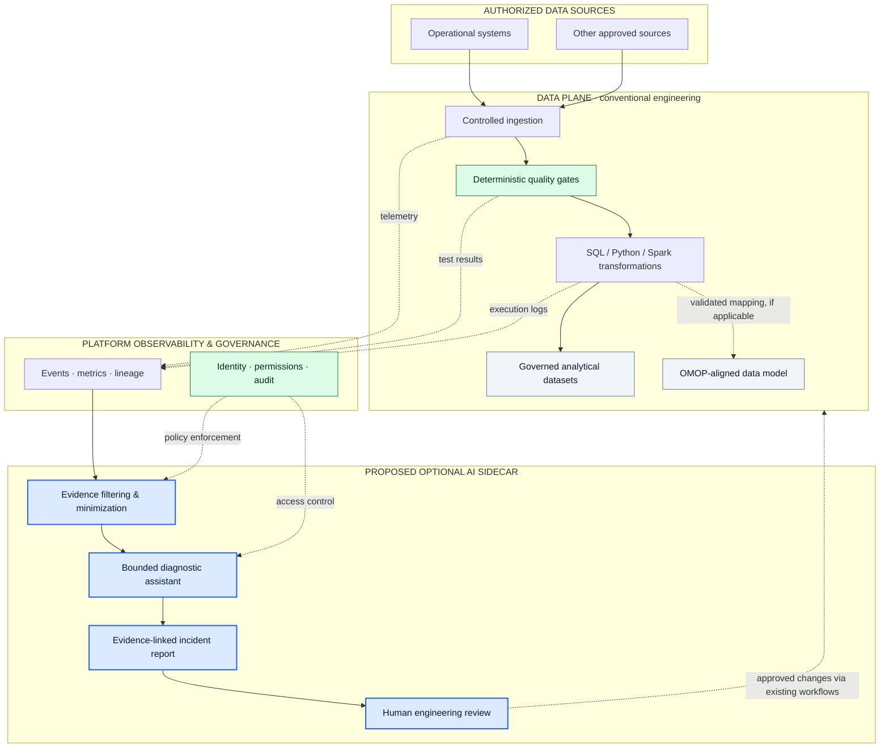
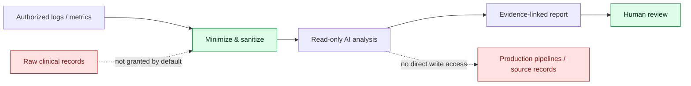

# Intelligent Data Pipeline Engineering

### Secure by Design · Efficient by Architecture · AI-Assisted by Purpose

**An independent architecture study for trustworthy data engineering in regulated environments.**

[Architecture](#architecture-overview) · [Principles](#design-principles) · [Security](#security-boundaries) · [Evaluation](#evaluation-framework) · [Roadmap](#research-roadmap)

  

> [!IMPORTANT]
> **Conceptual proposal—not a deployed product.** This independent study is not affiliated with or endorsed by HUS. It does not describe HUS's internal architecture, use patient data, or claim validated performance results. No implementation is planned as part of this repository.

---

## The idea in 60 seconds

Data platforms already provide ingestion, transformation, quality controls, monitoring, lineage, and governance. Rather than replacing them with AI, this study explores a narrower question:

**Can an isolated, evidence-grounded AI assistant make data-pipeline incidents easier to investigate without compromising security, integrity, availability, or efficiency?**

The proposed assistant is an **optional advisory sidecar**. Existing deterministic checks remain authoritative. It reads permitted operational evidence, explains anomalies, and suggests verification steps for engineers. It does **not** modify clinical records, rewrite pipelines, or authorize remediation.

> **Design thesis:** Use mature platform capabilities first. Introduce AI only when its measured benefit exceeds its cost, risk, and complexity.

## Architecture overview

The diagram distinguishes the **critical data plane** from the **optional advisory plane**. This is a reference concept, **not** a map of any real hospital deployment.

**Important distinctions:** The assistant is outside the critical processing path. If it fails, approved data workflows remain governed by their normal controls. A failed mandatory quality check must **not** be bypassed. **OMOP is a common data model used as a transformation target**, not an operational source equivalent to a patient record system.

### Responsibility matrix

| Component | Primary responsibility | AI authority |
|---|---|---|
| Data pipelines | Ingest, validate, transform, publish | None required |
| Platform controls | Quality, lineage, permissions, auditing | None required |
| Diagnostic sidecar | Summarize evidence, propose hypotheses | Read-only and advisory |
| Human review | Validate diagnoses and approve changes | Final decision remains with authorized staff |

## Design principles

| Principle | Architectural implication |
|---|---|
| **Security × efficiency** | Optimize performance within mandatory security constraints; measure both. |
| **Platform-native first** | Evaluate existing Azure/Databricks features before proposing custom components. |
| **Deterministic by default** | Use testable rules for schema, completeness, freshness, reconciliation, and integrity. |
| **No critical-path AI** | Inference must not block essential ingestion or bypass quality controls. |
| **Least privilege** | Prefer authorized metrics, metadata, and sanitized logs over raw records. |
| **Evidence over confidence** | Separate observed facts, possible causes, and recommended checks. |
| **Human-controlled changes** | No autonomous writes to source records or production pipelines. |
| **Falsifiable value** | Keep the simpler baseline if AI does not improve measured outcomes. |

## Illustrative incident

A scheduled pipeline usually produces approximately **100,000 records**, but its latest run produces **40,000**.

| Diagnostic field | Example output |
|---|---|
| **Observed** | Output volume dropped by 60% against the selected reference. |
| **Possible explanations** | Late upstream delivery, schema drift, changed filtering, partial processing. |
| **Evidence to inspect** | Source timestamps, schema versions, rejected-row counts, execution logs. |
| **Action** | Engineer investigates; assistant performs no correction. |

*This is a hypothetical example, not a measured result or a claim about HUS.*

## Security boundaries

Key risks include sensitive-data exposure, unsupported diagnoses, prompt injection via log content, privilege escalation, audit gaps, and inference outages. Proposed safeguards include input minimization, policy-enforced access, treating retrieved content as untrusted, no production write permissions, traceable evidence references, timeouts, and human approval.

**Compliance is not claimed.** Any deployment in a healthcare setting would require a specific legal, privacy, security, and operational assessment under applicable EU and Finnish requirements.

## Existing technology: assess before building

The following are **research areas**, not assertions about what HUS has deployed or what its platform lacks.

| Capability to investigate | Candidate platform features | Key question |
|---|---|---|
| Pipeline execution | Azure Databricks, Spark, Lakeflow | What incident evidence is already available? |
| Quality validation | Expectations, constraints, SQL/Spark checks | Is any additional intelligence necessary? |
| Governance | Unity Catalog access control and lineage | Can evidence be safely exposed to an assistant? |
| Monitoring | Event logs and platform monitoring | Is diagnostic assistance already built in? |
| AI lifecycle | Managed serving, evaluation, and governance | Would a custom sidecar be redundant? |

Primary documentation to verify current capabilities: [Azure Databricks](https://learn.microsoft.com/en-us/azure/databricks/), [Databricks](https://docs.databricks.com/), and [OHDSI OMOP Common Data Model](https://ohdsi.github.io/CommonDataModel/). Product capabilities and licensing may change; documentation must be checked before drawing conclusions.

## Evaluation framework

**No implementation or benchmark exists in this repository.** If this concept were ever evaluated, the correct comparison would be **platform-native diagnostics alone** versus **the same diagnostics plus an optional AI assistant**, using synthetic incidents.

| Dimension | Suggested measurement | Acceptance logic |
|---|---|---|
| Diagnostic quality | Correctness, evidence coverage, unsupported claims | Must outperform or meaningfully complement baseline |
| Engineer efficiency | Time to understand incident, including review | Measure end-to-end, not only response speed |
| Resource efficiency | Inference latency, compute cost per incident | Benefits must justify operational overhead |
| Security | Access-policy tests, sensitive-data leakage tests | Mandatory controls must hold independently |
| Resilience | Behavior when assistant is unavailable | No bypass of critical validation or approvals |
| Maintainability | Complexity, dependencies, review burden | Reject unjustified components |

**Decision rule:** If the sidecar fails to demonstrate a meaningful benefit under the required security constraints, **do not add it**.

## Research roadmap

1. **Verify** official Azure and Databricks capabilities and their limitations.
2. **Identify** a specific pipeline-triage gap not already solved by native tools.
3. **Specify** a minimal, read-only advisory interface and its evidence boundaries.
4. **Threat-model** the design and document failure behavior.
5. **Define** an evaluation method with a non-AI baseline.
6. **Decide** whether a future proof of concept would be justified. **Coding is outside this repository's scope.**

## Future vision — not part of the proposed baseline

The original research explored two complementary ideas: **internal intelligence for data operations** and a **policy-governed hybrid orchestration layer** for approved AI services. A shared, governed knowledge layer could preserve metadata and validated operational decisions independently of any model provider.

This broader architecture remains a **hypothesis for future study**. It raises additional issues of vendor controls, data residency, authorization, model equivalence, costs, and continuity. It is deliberately **not** required for the focused pipeline-diagnostics concept, and no external transfer of protected healthcare data is assumed.

## Evidence discipline and limitations

| Label | Meaning |
|---|---|
| **Verified** | Supported by a specific primary source or reproducible observation |
| **Inferred** | Reasoned interpretation, with explicit assumptions |
| **Hypothesis** | Plausible proposal requiring verification or testing |
| **Rejected** | Incorrect, unsafe, redundant, or unjustified option |

A critical review of an earlier concept identified four important corrections incorporated here: avoid overengineering; keep the proposal aligned with **data engineering**, not generic AI architecture; represent **OMOP as a target model**, not a source system; and do not infer internal technical requirements from public procurement notices.

**Limits:** No access to HUS internal systems or telemetry; no production measurements; no claim of a unique capability; no deployment, prototype, or clinical use. Public job postings and procurement material provide context only—not proof of an unmet technical need.

---

### Good data engineering first. AI only when justified.

*Independent research · Conceptual architecture · No clinical data · No production system*

