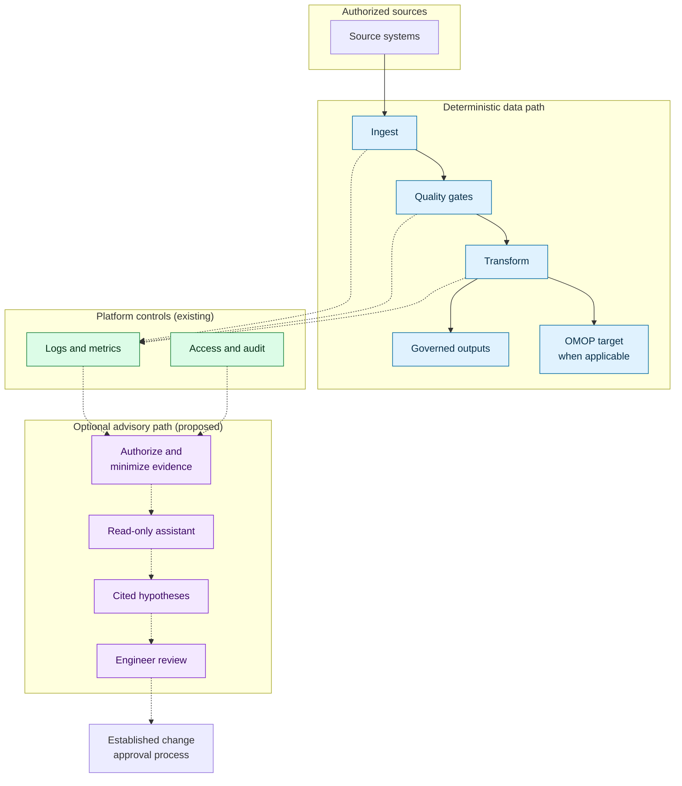
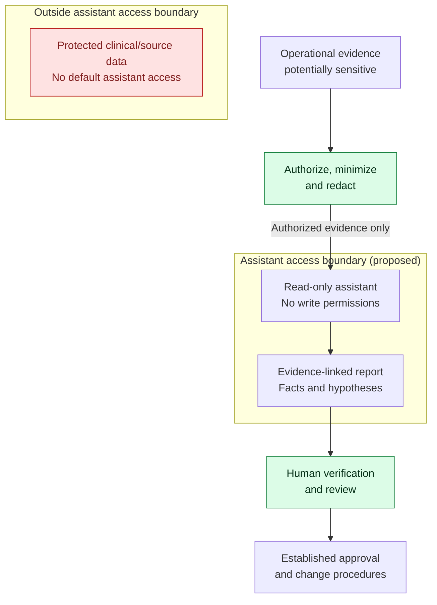

# Intelligent Data Pipeline Engineering

### Secure by Design · Efficient by Architecture · AI-Assisted by Purpose

**An independent study on evidence-grounded pipeline diagnostics in regulated data environments.**

   

[Summary](#summary) · [Findings](#what-the-platform-already-does) · [Open question](#the-narrowed-question) · [Architecture](#reference-architecture) · [Scenario](#illustrative-incident) · [Safety](#security-and-efficiency) · [Evaluation](#evaluation) · [Next steps](#next-steps)

## Summary

- **What this is:** a short study of one question in data engineering: when several pipeline alerts fire together, can an optional, read-only assistant help engineers find the common cause faster, without weakening security or controls?
- **What I checked:** I reviewed official Databricks and Azure Databricks documentation (consulted 2 Nov 2026) to see how much of this the platform already does.
- **What I found:** quite a lot. Error diagnosis, expectation-based quality checks, event logs, lineage and AI-driven anomaly detection already exist natively. The open part is narrower than I first assumed (see below).
- **Decision rule:** if native tooling is adequate, or AI cannot show a measurable benefit under strict security constraints, the AI component should not be added.

> [!NOTE]
> **Independent study, not an HUS project.** It makes no claim about HUS's internal systems or needs, uses no patient data, and describes no implemented solution. A prototype with synthetic data is a possible next step, not a deliverable that exists today.

## What the platform already does

**Documentation verified: 2 Nov 2026.** The capabilities below are supported by the linked official documentation, not by execution tests. Preview labels apply to the specific feature or table, not the whole platform. Availability and permissions still need checking for each cloud, region and workspace; an absent preview label is not proof of general availability.

| Capability | What the documentation describes | Source |
|---|---|---|
| **Job failure diagnosis** | The Lakeflow Jobs UI offers *Diagnose Error* using Genie Code. The current page does not state preview status or a notebook-only restriction; those details remain unverified. | [Troubleshoot and repair job failures](https://learn.microsoft.com/en-us/azure/databricks/jobs/repair-job-failures) |
| **AI coding and debugging assistant** | Current documentation uses **Genie Code** rather than the earlier Assistant wording. It works in notebooks, the SQL editor and Lakeflow Pipelines Editor, using Unity Catalog context including lineage. It can run code and perform permitted operations, so it is **not read-only by default**; model context can include data samples and cell outputs. | [Databricks Genie Code](https://docs.databricks.com/aws/en/genie-code/), [Azure Databricks Genie Code](https://learn.microsoft.com/en-us/azure/databricks/genie-code/) |
| **Rule-based quality checks** | Lakeflow Spark Declarative Pipelines expectations can retain invalid rows with warnings, drop them, or fail an update. Warn/drop metrics can be queried in the event log; fail-on-violation does **not** record expectation metrics. | [Expectations](https://docs.databricks.com/aws/en/ldp/expectations) |
| **Pipeline observability** | The pipeline event log is a queryable Delta table containing audit events, quality results, progress and lineage. Avoid monitoring or alerts based on `EVOLVING` or `DEPRECATED` fields. The separate regional `pipeline_events` system table is **Beta**. | [Pipeline event log](https://learn.microsoft.com/en-us/azure/databricks/ldp/monitor-event-logs), [Event log schema](https://learn.microsoft.com/en-us/azure/databricks/ldp/monitor-event-log-schema) |
| **Data quality monitoring** | Includes data profiling and anomaly detection. Anomaly detection (**Public Preview**) models commit freshness and row-count completeness, prioritises scans by downstream usage, and uses lineage to identify likely upstream causes. Results are stored in `system.data_quality_monitoring.table_results` (**Public Preview**). | [Overview](https://learn.microsoft.com/en-us/azure/databricks/data-governance/unity-catalog/data-quality-monitoring/), [Anomaly detection](https://learn.microsoft.com/en-us/azure/databricks/data-governance/unity-catalog/data-quality-monitoring/anomaly-detection/), [Results table](https://learn.microsoft.com/en-us/azure/databricks/admin/system-tables/data-quality-monitoring) |
| **Unity Catalog lineage** | Captures supported runtime table/column dependencies. Lineage system tables include job, pipeline and run identifiers where available, but capture only a subset of read/write events. | [Unity Catalog lineage](https://learn.microsoft.com/en-us/azure/databricks/data-governance/unity-catalog/data-lineage), [Lineage tables](https://learn.microsoft.com/en-us/azure/databricks/admin/system-tables/lineage) |
| **System tables** | The `system` catalog provides operational history, including job/task run timelines and lineage. Access requires Unity Catalog and appropriate grants; retention, regional coverage and preview status vary by table. | [System tables reference](https://learn.microsoft.com/en-us/azure/databricks/admin/system-tables/) |

**Inferred overlap:** my original idea of a sidecar that explains anomalies overlaps substantially with these features, especially Data Quality Monitoring with upstream root-cause pointers and Genie Code's error diagnosis. Anyone proposing an additional AI layer must show what these do not cover.

## The narrowed question

What is *not* clearly covered by the documentation I reviewed, and therefore remains **open (hypothesis, not finding)**:

1. **Cross-signal correlation with cited evidence.** Native tools already diagnose failed jobs and use lineage to identify likely upstream causes of table anomalies. The remaining question is whether they adequately connect *several* signals, such as a late delivery, a schema change and a downstream failure, into one explanation that cites specific logs and schema versions and separates fact from hypothesis.
2. **Use in a strict regulated context.** Some relevant features and system tables are in preview. For a healthcare organisation the practical questions are which model processes the logs, where, under which data-residency terms, with what audit trail, and whether the feature may be enabled at all.
3. **Governance of the advisory output.** Whether the explanation can be made read-only, minimised, reproducible and reviewable by an engineer before anything changes.

If native tools already answer 1 to 3 in a given environment, the right outcome is to use them and stop.

## Reference architecture

A technology-agnostic reference design, not a map of any real deployment. **Legend:** blue = deterministic processing; green = existing platform controls; purple = proposed optional advisory steps. Solid arrows carry source/processed data; dashed arrows carry operational evidence or review handoffs. Human approval uses the established change process.

**Rules:**

- The pipeline runs without the assistant, and mandatory quality gates can never be bypassed.
- The assistant sees only authorized, minimized operational evidence (metrics, schema versions, sanitized logs) and has no write access to source records or production pipelines.
- An engineer validates every conclusion and uses the normal change process.
- OMOP (Observational Medical Outcomes Partnership) is a common data model used as a **transformation target**, not an operational source comparable to a patient record system.
- The advisory path could be built from native components where they fit, so the sidecar may be a thin layer or may not be needed at all.

## Illustrative incident

**Three alerts, one possible upstream cause.** A synthetic exercise, not a recorded incident or a benchmark.

| Alert | Deterministic observation | Evidence to correlate |
|---|---|---|
| A · Volume | Row count is below a configured threshold at the delivery deadline | Delivery timestamps, upstream run history |
| B · Schema | A required field violates a configured non-null check | Source schema versions, column mappings |
| C · Execution | A dependent transformation fails | Job dependencies, error logs |

**Scenario ground truth (for future evaluation):** an upstream release renamed a field and delayed delivery; a permissive mapping populated the missing old field with nulls, and a dependent transformation rejected them. This is a stipulated cause, not a demonstrated finding, and must be withheld from the investigator during evaluation.

**Deterministic detection** produces the alerts above. **Evidence correlation** aligns timestamps, dependencies and schema versions; rules, queries and native tooling can do this too. **Hypothesis generation** proposes an upstream release as a possible common cause; timing alone does not prove it. **Human verification** checks the release history and mapping against the evidence before accepting or rejecting that explanation.

The test is whether adding an assistant to the same native tools and deterministic workflow provides measurable benefit. It would need to:

1. link the three alerts to one window and one probable cause,
2. cite the specific log lines, timestamps and schema differences,
3. label what is observed versus hypothesised,
4. propose safe verification steps, and
5. leave every decision to the engineer.

## Security and efficiency

Security and efficiency are evaluated together; mandatory controls are not trade-offs.

Protected data has no connector to the advisory path. Operational evidence is not automatically safe: logs, schema metadata and monitoring results may contain sensitive values. Authorization and minimization must happen before assistant access, enforced through permissions and restricted evidence views rather than prompts alone.

| Requirement | Safeguard or test |
|---|---|
| Data protection | Least privilege, sanitized logs, no raw patient data by default |
| Integrity | Deterministic quality gates; the assistant never writes to operational data |
| Traceability | Evidence references, audit logs, explicit statement of uncertainty |
| Availability | An assistant outage must not interrupt safe pipeline execution |
| Security testing | Prompt injection through log content, unauthorized access, data leakage |
| Efficiency | End-to-end triage time, inference overhead and cost |

Any healthcare deployment would need its own legal, privacy, security and operational review under applicable EU and Finnish requirements. No compliance is claimed.

## Evaluation

A fair test compares **native tools and deterministic workflows alone** with **the same workflow plus the optional assistant**, using synthetic incidents with known causes.

| Metric | Question |
|---|---|
| Root-cause accuracy | Is the supported diagnosis correct? |
| Evidence quality | Are claims tied to relevant logs, schemas and timestamps? |
| Unsupported claims | Does it invent causes? |
| Engineer effort | Is end-to-end investigation time lower, including review? |
| Overhead | Are latency and compute cost justified? |
| Safety | Do permissions and write restrictions hold under failure? |

**Reject or redesign** the assistant if it does not clearly beat the baseline or adds unacceptable risk.

## Next steps

1. Write 3 or 4 synthetic multi-signal incidents (alerts, logs, schema versions, true cause) in a small `examples/` folder.
2. Confirm feature availability, permissions and cost in a suitable test workspace, then run native diagnosis on synthetic incidents and record what it does and misses.
3. Update the "narrowed question" section with the results, even if the result is "the platform already covers this."
4. Threat-model the advisory boundary and define safe failure behavior.
5. Decide whether a small prototype is justified.

## Longer-term direction (not part of the baseline)

The earlier exploration also considered internal intelligence for data operations and a policy-governed layer that routes between approved AI services, backed by reusable operational knowledge. These remain **future hypotheses**. They would need separate analysis of privacy, data residency, vendor terms, cost, reliability and authorization, and nothing here assumes protected healthcare data leaves a controlled environment.

## Evidence labels and limits

| Label | Meaning |
|---|---|
| **Verified** | Supported by a primary source or a reproducible test |
| **Unverified** | Claim without accessible supporting evidence; not a finding |
| **Inferred** | Reasoned conclusion with stated assumptions |
| **Hypothesis** | Proposal awaiting verification |
| **Rejected** | Discarded after technical or safety review |

The capability descriptions in the findings table are *verified against accessible documentation only*, not by running the features. **Still unverified:** target-workspace availability; preview/GA status where the linked page gives none; and whether native tooling satisfies the full cross-signal and advisory-governance requirements. The earlier notebook-only diagnosis restriction and February 2026 launch-date claim remain unverified and are excluded from the findings. Preview status, naming and availability change often, so re-check before relying on it.

I have no access to any organisation's internal systems or telemetry, and public job postings or procurement notices show context, not unmet needs.

Independent individual research, published under the CAUCOLabs namespace. It is not a commercial offer or an official design of any organisation.

---

**Good data engineering first. AI only when justified.**

*Conceptual study · Synthetic scenarios · No clinical data · No claimed deployment*

